# Code Review Requests

An Orca plugin that lists your GitLab **Review Requests** (open, non-draft merge requests where you are a Reviewer and have neither approved nor requested changes): a count in the status bar, a panel, and review workspaces. See `GLOSSARY.md` at the repo root for the vocabulary.

## Review lifecycle

Each Review Request sits in one of the panel's tabs: **Todo**, **Reviewing** or **Done**. The tab follows the review round, not just whether a Review Workspace exists ([ADR 2](../../docs/adr/0002-code-review-requests-tab-follows-review-round.md)): a re-requested review goes back to Todo even while its old workspace is still there.

```mermaid
stateDiagram-v2
    state "Todo" as Todo
    state "Todo, re-requested<br/>(shows what you did last round;<br/>old workspace may still be there)" as ReRequested
    state "Reviewing" as Reviewing
    state "Done<br/>(still has its workspace)" as Done
    state "Off the list<br/>(last outcome remembered)" as Finished

    [*] --> Todo: added as Reviewer
    Todo --> Reviewing: Start Review (creates the workspace)
    ReRequested --> Reviewing: Start Review (reuses the workspace,<br/>moved to the new commits)
    Reviewing --> Todo: Delete workspace<br/>(Review Draft discarded)
    Reviewing --> Reviewing: post Comment
    Reviewing --> Done: post Approve or Request changes;<br/>merged, closed, removed as Reviewer
    Reviewing --> ReRequested: author re-requests (after a comment)
    Todo --> Finished: Approve or Request changes<br/>on gitlab.com
    Done --> ReRequested: author re-requests
    Finished --> ReRequested: author re-requests
    Done --> [*]: workspace removed<br/>(by hand, or automatically after N days)
    Todo --> [*]: merged, closed, removed as Reviewer
    Finished --> [*]: merged or closed (looked up hourly)
```



- **Done** lists only Ended Review Requests that still have their Review Workspace. Without one, an ended review drops off the list; the plugin still remembers your last outcome so a re-request can say what it was.
- **Approve** and **Request changes** end your part of the review. **Comment** keeps the card under Reviewing.
- **Posting** any outcome clears the Agent Findings and diff-view notes you left unchecked from the Review Draft. Posted comments stay as history.
- **Re-requesting** doesn't restart the overdue clock: it counts from when you were first added as Reviewer.
- **Made draft** hides a Review Request without ending it. It comes back where it was once it's ready again.
- **Stored data stays bounded.** A Review Draft is deleted as soon as no workspace belongs to its MR, however the workspace went (from the panel, in Orca, or with the CLI); this check only runs while the worktree list can be read. Done entries go with their workspace. A remembered last outcome goes once its MR is merged or closed. The notifier's and the New badge's lists only ever hold what is listed now.

## Layout

- `orca-plugin.json`: the manifest. It declares every v1 capability and contribution up front, so updates keep the user's approval.
- `src/worker.ts`: the worker. `createActivate(deps)` builds `activate`; the default export uses `realDeps()` from `src/deps.ts`.
- `src/panel.tsx`: the components panel. `src/panel.check.ts` has one `orca plugin check` scenario per panel state.
- `src/protocol.ts`: the panel/worker request contract.
- `src/settings.ts`: the settings and their defaults (the test host and `check` don't apply manifest defaults).
- `src/seams/`: the outside world, behind interfaces: `GitLabTransport`, `OrcaCli`, `Clock`.
- `src/fakes/`: in-memory doubles for each seam (`fakeDeps()`), including a stateful fake GitLab.
- `src/smoke/`: the opt-in live smoke script (see below). The plugin never loads it.
- `images/`: the icon, cover and screenshots for the plugin page. The cover (`cover.jpg`) is made by hand, with the cards from `scripts/images/review-cards.png`; `scripts/images/render.sh` renders the icon and screenshots from `scripts/images/mock.html` (made-up data, headless Chrome); edit the mock and re-run it rather than shipping real screenshots.
- `scripts/release.sh` and `src/release/`: the release script and the catalog merge it uses (see below). The plugin never loads them.

## Install

The plugin is published in this repo's own catalog, `orca-catalog.json` at the repo root. Add the catalog once, then install:

```sh
orca plugin catalog add drdla/orca-addons     # prints a fingerprint; re-run with --approve <fingerprint>
orca plugin install drdla.code-review-requests # likewise asks for --approve <fingerprint>
```

Or in Orca: Settings → Plugins → ⋯ → Catalog sources…, add `https://github.com/drdla/orca-addons.git` (ref `main`), then install Code Review Requests from the plugin list. Orca shows what the plugin may do and asks you to approve it. Then open its Settings (the gear in the panel) and point it at your GitLab instance; it reads GitLab through `glab`, so run `glab auth login` first.

Updates arrive by themselves (Settings → Plugins → Update plugins automatically, on by default) once a release has been listed for 12 hours, or right away with `orca plugin update drdla.code-review-requests`. An update that asks for a new capability, command, panel or event waits for your approval ("Update needs review").

## Develop

```sh
npm install                 # TypeScript and Node typings, for type-checking only
orca plugin types .         # writes .orca/types (gitignored)
npx tsc -p .                # type-check
orca plugin test .          # unit and integration tests (node:test)
orca plugin check .         # renders the panel per scenario, with the real worker
orca plugin dev watch .     # load into Orca and reload on save
```

`activate` must not reach GitLab, spawn `glab` or `orca`, or start timers until GitLab is configured: `orca plugin check` runs the real worker once per scenario.

## Live smoke test

The tests only reach the fakes. `src/smoke/` is an opt-in script that runs the plugin's own modules (the glab transport, the Review Requests and approvals queries, `glab auth status` parsing, the orca CLI adapter, the Review Draft poster) against your real GitLab and Orca. It needs Node 22.18 or newer (it runs the TypeScript directly) and a `glab auth login`.

```sh
npm run smoke                      # read-only: writes nothing to GitLab or Orca
npm run smoke -- --host gitlab.example.com   # check that host instead of glab's first login
```

The read-only run checks glab (found, logged in), the GitLab version, the current user, the Review Requests query and its response shape, the reviewers call behind "requested at", the optional approvals query, and the JSON of `orca worktree list` and `orca worktree ps`. It prints PASS, WARN, FAIL or SKIP per check and exits 1 if any check failed. A shape note such as "keys added or missing vs. the capture" means the live answer drifted from the sanitized captures in `src/fixtures/`; it fails only for a field the plugin reads.

```sh
npm run smoke -- --post --mr https://gitlab.example.com/group/project/-/merge_requests/7
npm run smoke -- --post --mr <url> --file src/a.ts --line 12   # put the line comment here
npm run smoke -- --post --mr <url> --approve                   # also approve the MR
```

`--post` writes to that one MR only, so use a sandbox MR you own. It publishes one review with two Review Comments, a line comment on the first added line of the diff (or `--file`/`--line`) and a general comment, plus a summary. Every body is tagged `[crr-smoke-<id> …]`. Approving needs `--approve` as well. Before writing anything, it prints the plan and waits for you to type `post` (`--yes` skips the prompt). It refuses to run when you have your own pending drafts on the MR, because publishing would publish them too. Afterwards it reports the note URLs, whether the line comment landed as a diff note, whether the summary shows up, and that no drafts were left behind.

## Release

A release is a `releases` entry in `orca-catalog.json` that pins one commit of this folder and its content hash. Orca installs exactly those bytes, so a release needs no tag and no build.

1. On a branch (not `main`), raise `version` in `orca-plugin.json` and commit it with the code. Never reuse a released version: installs of the old commit don't see a same-version release as newer.
2. Delete `node_modules/` (Orca refuses to install a folder holding a symlink, and `npm install` creates them) and make sure the tree is clean.
3. Run the release script from anywhere in the repo:

   ```sh
   plugins/code-review-requests/scripts/release.sh            # all checks, then commit the catalog
   plugins/code-review-requests/scripts/release.sh --no-smoke # without glab or a GitLab login
   plugins/code-review-requests/scripts/release.sh --push     # also push the branch
   ```

   It refuses a dirty tree, `node_modules/` or a symlink in this folder, then runs `orca plugin validate`, `tsc` (with TypeScript and the Node typings installed in a temporary folder, so nothing is left here), `orca plugin test`, `orca plugin check` and the read-only smoke. It writes `orca plugin release-entry`'s entry for the committed `HEAD` into `orca-catalog.json`, newest first, replacing a release of the same version and refusing one older than the newest listed (`src/release/catalog.ts`), validates the catalog and commits it. It never pushes `main`.
4. Open a PR and **merge it with a merge commit**, not squash or rebase: the release pins the plugin commit, which a squash or rebase leaves off `main`, and Orca then can't download it.

After the merge, installs update within about 12 hours, or at once with `orca plugin update drdla.code-review-requests`.
